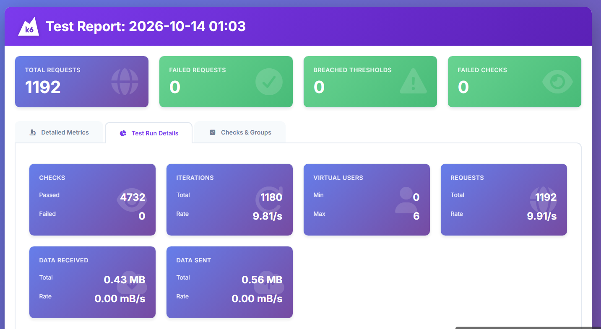
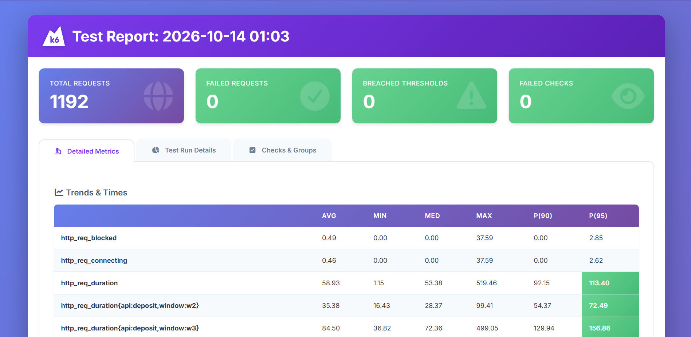
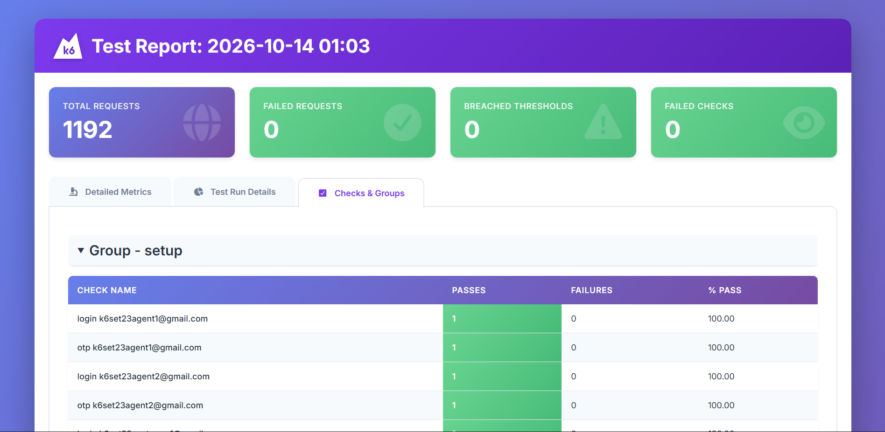
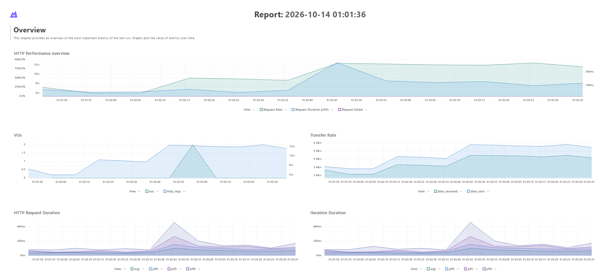
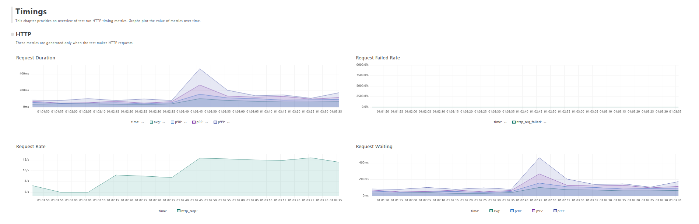
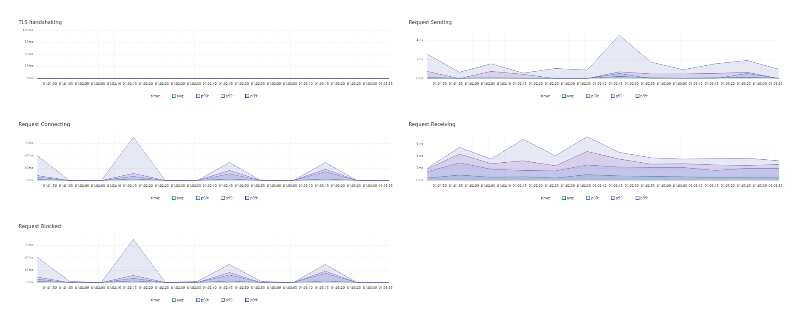
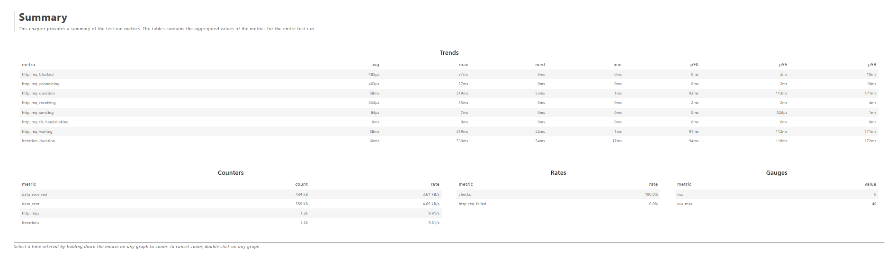

# DMoney Performance Test with k6

A k6 load test that simulates six DMoney users (2 agents, 2 customers, 2 merchants) running **Deposit**, **Send Money** and **Payment** transactions for **2 minutes**, split into four 30-second windows. It checks every response, enforces thresholds (global and per API), produces an HTML report, and compares the three APIs on response time, throughput, failure rate and degradation as the workload changes.

## 1. What the test does

Every flow runs at a steady **3 transactions per second** (10 Tk each). All flows in the same window run **concurrently** for the whole window. Each user logs in with their own credentials (login, then dev OTP `0000`) before the test starts.

| Window | Flows running at the same time |
|---|---|
| **W1 · 0–30 s** | Customer 1 → Send Money → Customer 2 · Customer 2 → Payment → Merchant 1 |
| **W2 · 30–60 s** | Customer 2 → Send Money → Customer 1 · Agent 1 → Deposit → Customer 2 · Customer 1 → Payment → Merchant 1 |
| **W3 · 60–90 s** | Agent 1 → Deposit → Customer 1 · Agent 2 → Deposit → Customer 2 · Customer 1 → Send Money → Customer 2 · Customer 2 → Payment → Merchant 2 |
| **W4 · 90–120 s** | Agent 1 → Payment → Merchant 1 · Agent 2 → Payment → Merchant 2 · Customer 1 → Payment → Merchant 1 · Customer 2 → Payment → Merchant 2 |

APIs under test: `POST /transaction/deposit`, `POST /transaction/sendmoney`, `POST /transaction/payment`.

## 2. Project structure

```
.
├── README.md
├── config/
│   └── settings.js            # base URL, partner key, OTP, rate, amount, the 6 test users
├── lib/
│   ├── auth.js                # login + OTP verify, returns a JWT token
│   ├── transactions.js        # one transaction call + its 4 checks
│   └── report.js              # HTML report + API comparison table
├── scripts/
│   ├── seed-users.js          # create, activate and fund the 6 users
│   └── dmoney-load-test.js    # the 2-minute test (has the default function)
├── sql/
│   ├── disable-limits.sql     # customer limits off, run before the test
│   ├── restore-limits.sql     # customer limits back on (optional)
│   ├── add-index.sql          # index on Transactions(account), see section 9
│   └── drop-index.sql         # remove that index again
├── reports/
│   ├── report.html            # k6 HTML report
│   ├── dashboard.html         # k6 web dashboard export
│   └── comparison.md          # API comparison tables
└── screenshots/               # images used in this README
```

### How the main script is organised

`scripts/dmoney-load-test.js` reads top to bottom in this order:

1. **FLOWS**: the 13 flows from the assignment (who calls which API, to whom, in which 30-second window).
2. **Scenarios**: one k6 scenario per flow; `startTime` (0 s, 30 s, 60 s, 90 s) makes flows in the same window run concurrently.
3. **Thresholds**: global, Deposit, Send Money and Payment, written out one by one.
4. **`options`**: scenarios + thresholds.
5. **`setup()`**: each of the six users logs in with their own credentials (login, then OTP `0000`).
6. **`export default function (data)`**: the default function. Every scenario runs it; it looks up its flow, then sends one transaction as the sender through `transact()` in `lib/transactions.js`, which also runs the four checks.
7. **`handleSummary()`**: writes the HTML report and the comparison files (see `lib/report.js`).

## 3. Prerequisites

- [k6](https://k6.io/docs/get-started/installation/) (tested with v2.2.0)
- DMoney API running locally on `http://localhost:5000` with its MySQL database
- Header `X-AUTH-SECRET-KEY: ROADTOSDET` is sent on every call (override with `PARTNER_KEY`)
- Dev OTP `0000` (login uses `POST /user/verify-otp?env=dev`)
- The HTML report downloads its template from GitHub, so an internet connection is needed when the test ends

## 4. How to run

Run every command from the project root, in PowerShell. Use your own MySQL path and credentials in the `mysql` lines (or run the `.sql` files in MySQL Workbench).

```powershell
# 1. Start the DMoney API (its own project) and check it answers. Expected: {"message":"Server is up"}
curl.exe http://localhost:5000/

# 2. Prepare the database: customer limits off + index on (see section 9 for why)
#    If the index already exists, the second command reports "Duplicate key name"; that is harmless.
Get-Content sql\disable-limits.sql | & "C:\Program Files\MySQL\MySQL Server 8.0\bin\mysql.exe" -u root -p dmoneydb
Get-Content sql\add-index.sql | & "C:\Program Files\MySQL\MySQL Server 8.0\bin\mysql.exe" -u root -p dmoneydb

# 3. Create, activate and fund the 6 test users (safe to re-run)
New-Item -ItemType Directory -Force data, reports | Out-Null    # k6 does not create folders
k6 run scripts/seed-users.js

# 4. Full 2-minute test + dashboard export
$env:K6_WEB_DASHBOARD="true"; $env:K6_WEB_DASHBOARD_EXPORT="reports/dashboard.html"
k6 run scripts/dmoney-load-test.js
```

The reports are written to `reports/` (`report.html`, `dashboard.html`, `comparison.md`, `summary.json`) and the console shows the pass/fail result of every threshold. k6 exits with code `0` when all thresholds pass and `99` when one fails (the reports are still written).

**Optional quick check** (5-second windows, 1 tx/s per flow, about 20 seconds). It writes to `reports/` too, so run step 4 afterwards, or the quick-check results stay in the report files:

```powershell
$env:WINDOW_SECONDS="5"; $env:RATE="1"; k6 run scripts/dmoney-load-test.js
Remove-Item Env:WINDOW_SECONDS, Env:RATE
```

**Repeat on clean accounts:** each run adds history to the test accounts. Pick an unused number, for example `$env:USER_SET="24"`, then run step 3 and step 4 again in the same window.

Settings you can change with environment variables: `RATE` (tx/s per flow, default 3), `AMOUNT` (Tk per tx, default 10), `WINDOW_SECONDS` (default 30), `USER_SET` (which set of six test users, default 21), `REPORT_DIR` (default `reports`), `BASE_URL`, `PARTNER_KEY`.

## 5. Checks and thresholds

**Checks on every transaction response** (4 per response, prefixed with the API name):

1. Status is `201`
2. Request successful (JSON body whose `message` says "successful")
3. Transaction ID (`trnxId`) is returned
4. Success message equals the expected text (`Deposit successful`, `Send money successful`, `Payment successful`)

Only HTTP `201` counts as a successful request. The API answers `208` for insufficient balance and `400` for limit errors, which k6 would normally treat as success, so the test marks them as failed.

**Thresholds** (global, and again for each of Deposit, Send Money and Payment):

| Metric | Threshold | Meaning |
|---|---|---|
| `http_req_failed` | `rate<0.01` | failed requests less than 1% |
| `http_req_duration` | `p(95)<1000` | 95% of requests below 1000 ms |
| `checks` | `rate>=0.99` | checks pass at least 99% of the time |

## 6. Results

One full 2-minute run: 1,180 transactions (about 9.8 per second), plus 12 login requests. Files are in [reports/](reports/).

### Threshold verdicts: all pass

| Threshold | Global | Deposit | Send Money | Payment |
|---|---|---|---|---|
| Failed requests `< 1%` | **PASS** 0.00% | **PASS** 0.00% | **PASS** 0.00% | **PASS** 0.00% |
| p(95) `< 1000 ms` | **PASS** 113.4 ms | **PASS** 137.0 ms | **PASS** 104.8 ms | **PASS** 108.9 ms |
| Checks `>= 99%` | **PASS** 100.00% | **PASS** 100.00% | **PASS** 100.00% | **PASS** 100.00% |

### API comparison (whole test)

| API | Requests | Req/s | Avg ms | p95 ms | Max ms | Failed |
|---|---|---|---|---|---|---|
| Deposit | 272 | 2.26 | 68.1 | 137.0 | 499.1 | 0.00% |
| Send Money | 272 | 2.26 | 50.8 | 104.8 | 338.4 | 0.00% |
| Payment | 636 | 5.29 | 59.4 | 108.9 | 519.5 | 0.00% |

### Per window (how performance changes as the workload changes)

| API · window | Requests | Req/s | Avg ms | p95 ms | Max ms | Failed |
|---|---|---|---|---|---|---|
| Send Money · W1 | 91 | 3.03 | 39.0 | 70.0 | 113.6 | 0.00% |
| Payment · W1 | 91 | 3.03 | 39.9 | 67.3 | 94.9 | 0.00% |
| Send Money · W2 | 90 | 3.00 | 34.9 | 58.2 | 101.5 | 0.00% |
| Deposit · W2 | 91 | 3.03 | 35.4 | 72.5 | 99.4 | 0.00% |
| Payment · W2 | 91 | 3.03 | 35.1 | 67.0 | 99.0 | 0.00% |
| Send Money · W3 | 91 | 3.03 | 78.2 | 132.1 | 338.4 | 0.00% |
| Deposit · W3 | 181 | 6.03 | 84.5 | 156.9 | 499.1 | 0.00% |
| Payment · W3 | 91 | 3.03 | 87.1 | 153.6 | 519.5 | 0.00% |
| Payment · W4 | 363 | 12.10 | 63.4 | 109.0 | 179.4 | 0.00% |

The same tables, generated by the script, are in [reports/comparison.md](reports/comparison.md).

## 7. Analysis

**Response time.** All three APIs stay far below the 1000 ms limit. Send Money is the fastest (average 50.8 ms, p95 104.8 ms), Payment is next (59.4 ms, p95 108.9 ms) and Deposit is the slowest (68.1 ms, p95 137.0 ms). Deposit does the most work per call (it locks both the agent's and the customer's balance), which fits it being the slowest. The slowest single request was 519.5 ms (a Payment in W3).

**Throughput.** Each flow was held at its target of 3 requests/s in every window, and the server kept up with no dropped iterations. Payment carries the most traffic (5.29 req/s overall) because it runs in 7 of the 13 flows; Deposit and Send Money run in 3 flows each (2.26 req/s). The busiest moments were W4 (four Payment flows, 12.10 req/s) and W3 for Deposit (two Deposit flows, 6.03 req/s).

**Failure rate.** None. 0.00% of requests failed for every API, and 100% of the 4,732 checks passed.

**Degradation as the workload changes.**

- **W1 and W2 (2 and 3 flows):** p95 is 58–73 ms for all APIs.
- **W3 (4 flows, including both Deposit flows):** every API slows down. p95 rises to 132–157 ms: Deposit 72.5 → 156.9 ms (+116%), Send Money 70.0 → 132.1 ms (+88%, W1 → W3), Payment 67.0 → 153.6 ms (+129%, W2 → W3). Averages roughly double (35–39 ms → 78–87 ms).
- **W4 (four Payment flows):** despite the highest request rate (12.10 req/s), Payment p95 drops back to 109.0 ms. That points to the mix of operations, not the raw request rate: in W3 deposits, sends and payments compete for the same two customer accounts and wait on each other's balance locks, while in W4 each payer works on a separate account.
- Even at its worst, no API gets near the 1000 ms limit and none fails a threshold.

**Takeaway.** Under this workload the three APIs are fast and reliable, and performance degrades gradually (about 2x at p95) when the heaviest mix of concurrent operations runs in W3, then recovers in W4.

## 8. Screenshots

> Add your screenshots to the [screenshots/](screenshots/) folder and keep the names below.

**HTML report, overview** (`reports/report.html`, "Test Run Details" tab): 1,192 requests, 0 failed, 0 breached thresholds, 4,732 checks passed.



**Metrics, response times** (`reports/report.html`, "Detailed Metrics" tab): average, median, p90 and p95 for all requests and for each API.



**Checks** (`reports/report.html`, "Checks & Groups" tab): the four checks for each API.



**Metrics dashboard** (`reports/dashboard.html`): the whole run over time. Overview first, then the Timings chapter (two parts, because the page is long), then the Summary tables.

*Overview:* request rate, p95 response time, failed requests, virtual users, transfer rate and iteration duration.



*Timings, part 1:* request duration, failed rate (flat at 0%), request rate and request waiting.



*Timings, part 2:* TLS handshaking, connecting, blocked, sending and receiving.



*Summary:* aggregated trends (avg, max, p90, p95, p99), counters, rates (`checks` 100%, `http_req_failed` 0%) and gauges.



## 9. Notes

- **Customer limits:** DMoney limits customers to 10 outgoing transactions and 5,000 Tk per day. A load test would hit that immediately (HTTP 400), so `sql/disable-limits.sql` turns the limits off for the test. `sql/restore-limits.sql` turns them back on.
- **Index on `Transactions(account)`:** the API runs `SELECT ... WHERE account = ? FOR UPDATE` on every transaction. With no index on `account`, MySQL scans and locks the whole table, so concurrent transactions deadlock (HTTP 500, `ER_LOCK_DEADLOCK`) and slow down as the table grows. In a trial run without the index (about 10,000 rows in `Transactions`) 13% of requests failed and p95 was about 2.4 s. The results above were measured with `sql/add-index.sql` applied; `sql/drop-index.sql` removes it again.
- **Numbers vary** from run to run, and a longer `Transactions` history makes the API slower. For a clean repeat, use a new `USER_SET` and run `scripts/seed-users.js` for it first.
- Each run moves small amounts of real balance between the six test accounts; re-run `scripts/seed-users.js` (same `USER_SET`) to top them back up.
- The test accounts use phone numbers `019<set>000001`–`019<set>000006`, so they do not clash with existing DMoney data.
